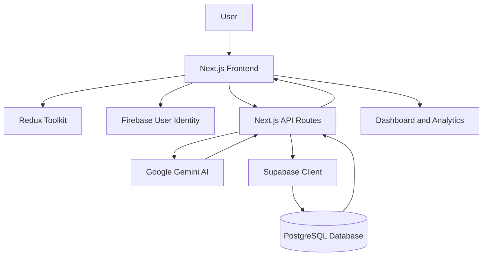
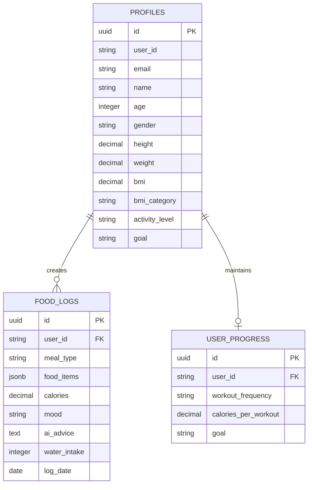
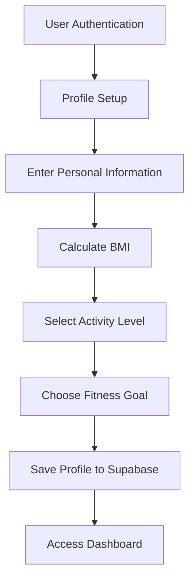
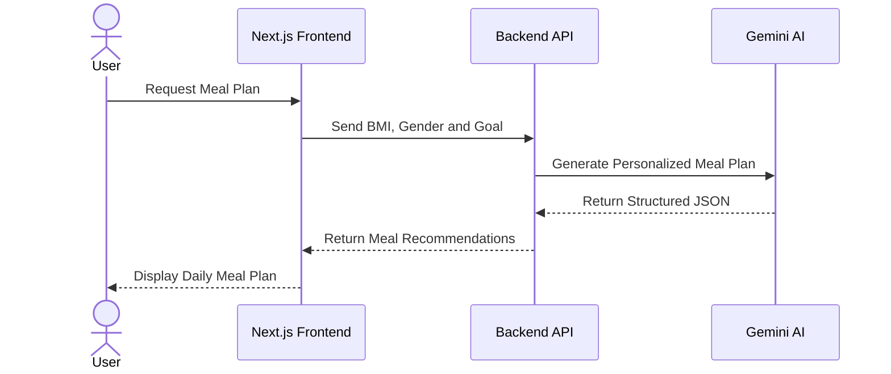
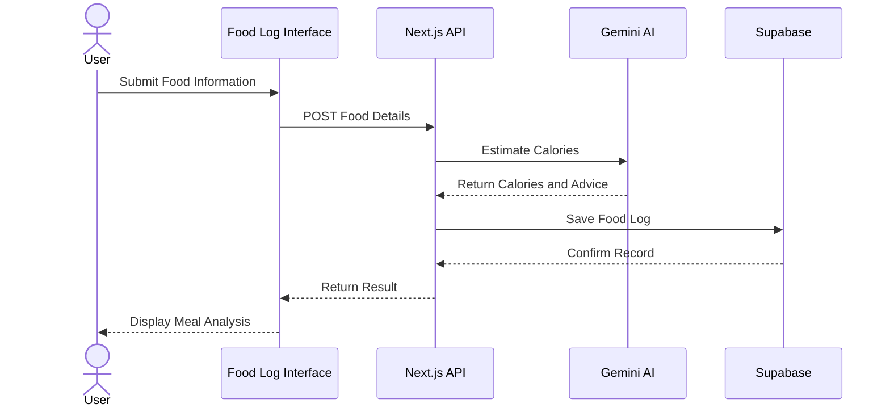

# 🥗 Smart AI Meal Planner

### AI-Powered Nutrition Tracking & Personalized Meal Planning Platform

Smart AI Meal Planner is a full-stack web application that helps users manage their daily nutrition, track calorie consumption, monitor hydration, and maintain fitness goals through AI-powered recommendations.

The application integrates Google Gemini AI to generate personalized meal plans, estimate food calories, and provide nutrition advice based on users' health profiles and fitness objectives.

## 🚀 Key Features

- **Personalized User Profiles:** Collects age, gender, height, weight, activity level, and fitness goals.
- **BMI Calculation:** Automatically calculates BMI and determines the corresponding BMI category.
- **AI Meal Planning:** Generates personalized breakfast, lunch, snacks, and dinner recommendations using Google Gemini AI.
- **AI Calorie Estimation:** Analyzes submitted food items and estimates their approximate calorie content.
- **Nutrition Recommendations:** Provides AI-generated dietary advice and personalized health tips.
- **Food Logging:** Allows users to record daily meals, food items, and mood.
- **Hydration Tracking:** Monitors daily water consumption.
- **Fitness Progress Tracking:** Calculates estimated calories consumed, calories burned, and net calorie balance.
- **Interactive Dashboard:** Visualizes nutritional activities and fitness statistics through charts.
- **Responsive UI:** Supports desktop and mobile layouts with light and dark themes.

## 🛠 Technology Stack

| Category | Technologies |
|---|---|
| Frontend | Next.js, React.js, TypeScript |
| Styling | Tailwind CSS |
| UI Components | Ant Design, Lucide React |
| State Management | Redux Toolkit |
| Backend | Next.js API Routes |
| Database | Supabase (PostgreSQL) |
| Authentication | Firebase |
| AI Integration | Google Gemini AI |
| Data Visualization | Recharts |
| Deployment Configuration | Netlify |

## 🏗 System Architecture

The application follows a client-server architecture. The frontend communicates with Next.js API routes, which handle business logic, AI integration, and database operations.



## 🗄 Database Design

The application uses **Supabase PostgreSQL** as its relational database.

The database is organized into three main tables:

### 1. Profiles

Stores personal and health-related information.

| Column | Description |
|---|---|
| id | Profile identifier |
| user_id | Firebase user UID |
| email | User email |
| name | Full name |
| age | User age |
| gender | Gender |
| height | Height in centimeters |
| weight | Weight in kilograms |
| bmi | Calculated BMI |
| bmi_category | BMI classification |
| activity_level | Physical activity level |
| goal | Fitness goal |
| created_at | Creation timestamp |
| updated_at | Last update timestamp |

### 2. Food Logs

Stores daily meal records, calorie estimations, nutritional advice, and hydration information.

| Column | Description |
|---|---|
| id | Food-log identifier |
| user_id | Associated user UID |
| meal_type | Breakfast, Lunch, Snacks, Dinner, or Water |
| food_items | List of food items |
| calories | Estimated calories |
| mood | User mood |
| ai_advice | AI-generated nutrition advice |
| water_intake | Water consumption |
| log_date | Record date |
| created_at | Creation timestamp |

### 3. User Progress

Stores fitness preferences and workout information.

| Column | Description |
|---|---|
| id | Progress identifier |
| user_id | Associated user UID |
| workout_frequency | Workout frequency |
| calories_per_workout | Estimated calories burned per workout |
| goal | Fitness objective |

### Entity Relationship Diagram (ERD)

The following diagram represents the logical relationships between the application's database entities.



**Note:** The ERD illustrates the intended logical relationships based on application queries. Exact SQL column types, constraints, and foreign-key enforcement should be verified against the actual Supabase schema.

## 🔄 Application Workflow

### 1. User Profile Setup



### 2. AI Meal Planning Workflow



### 3. Food Logging Workflow



## 🔌 Backend API Endpoints

| Method | Endpoint | Description |
|---|---|---|
| POST | `/api/aiMealPlan` | Generates personalized meal plans |
| POST | `/api/aiHealthTips` | Generates personalized health tips |
| GET | `/api/food-log` | Retrieves food-log records |
| POST | `/api/food-log` | Saves meals with AI calorie estimation |
| PATCH | `/api/food-log` | Updates daily water intake |
| GET | `/api/progress` | Retrieves calculated fitness progress |
| POST | `/api/progress` | Saves or updates workout preferences |
| GET | `/api/dashboard` | Retrieves dashboard analytics |

## 🤖 AI Integration

Google Gemini AI is integrated through the `@google/generative-ai` SDK.

The application uses AI for three major functionalities:

1. **Meal Plan Generation:** Generates daily meal recommendations based on BMI, gender, and fitness goals.
2. **Calorie Estimation:** Analyzes submitted food items and estimates their approximate calorie content.
3. **Health Recommendations:** Generates personalized nutritional advice and motivational health tips.

Structured JSON responses are used to maintain consistent API output. Fallback mechanisms are also implemented to handle AI service failures.

## 📊 Calorie Calculation

The application calculates calorie consumption and estimated workout expenditure.

**Total Calories Consumed**

\[
C_{consumed} = \sum Calories\ of\ Food\ Logs
\]

**Estimated Calories Burned**

\[
C_{burned} = Workout\ Frequency \times Calories\ Per\ Workout
\]

**Net Calorie Balance**

\[
C_{net} = C_{consumed} - C_{burned}
\]

These calculations are used to display simplified fitness progress indicators.

## 📂 Project Structure

```text
AI-Meal-Planner/
│
├── public/
│
├── src/
│   └── app/
│       ├── api/
│       │   ├── aiMealPlan/
│       │   ├── aiHealthTips/
│       │   ├── food-log/
│       │   ├── progress/
│       │   └── dashboard/
│       │
│       ├── components/
│       ├── dashboard/
│       ├── setup-profile/
│       └── page.tsx
│
├── package.json
├── next.config.ts
├── tailwind.config.cjs
├── tsconfig.json
└── README.md
```

## ⚙️ Installation & Setup

### Prerequisites

- Node.js
- npm
- Git
- Supabase account
- Google Gemini API key

### 1. Clone the Repository

```bash
git clone https://github.com/Shafaet1074/AI-Meal-Planner.git
```

### 2. Navigate to the Project

```bash
cd AI-Meal-Planner
```

### 3. Install Dependencies

```bash
npm install
```

### 4. Configure Environment Variables

Create a `.env.local` file in the project root.

```env
NEXT_PUBLIC_SUPABASE_URL=your_supabase_url
NEXT_PUBLIC_SUPABASE_ANON_KEY=your_supabase_anon_key
GEMINI_API_KEY=your_gemini_api_key
```

### 5. Run the Development Server

```bash
npm run dev
```

Open [http://localhost:3000](http://localhost:3000) in your browser.

## 🎯 Project Objectives

- Simplify daily nutrition and calorie management.
- Provide personalized meal recommendations using generative AI.
- Improve awareness of food consumption and hydration habits.
- Monitor fitness activities and calorie balance.
- Demonstrate the integration of modern frontend technologies, backend APIs, relational databases, and AI services in a full-stack application.

## 🔮 Future Improvements

- Food image recognition and calorie estimation.
- Detailed macronutrient tracking (protein, carbohydrates, and fats).
- Historical meal-plan storage.
- Advanced nutritional analytics and reports.
- Integration with external nutritional databases.
- Enhanced authentication and database security.

## 👨‍💻 Author

**Mohammad Shafaet Hossain**

Frontend Developer | React.js | Next.js | TypeScript

- GitHub: [Shafaet1074](https://github.com/Shafaet1074)
- Email: hossainshafaet63@gmail.com

---

**Built with ❤️ using Next.js, Supabase, Firebase, and Google Gemini AI.**
